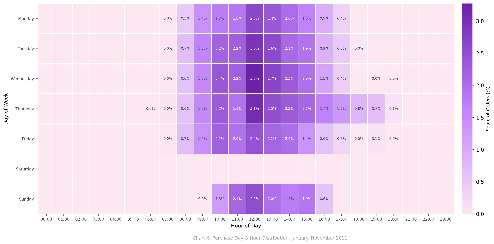
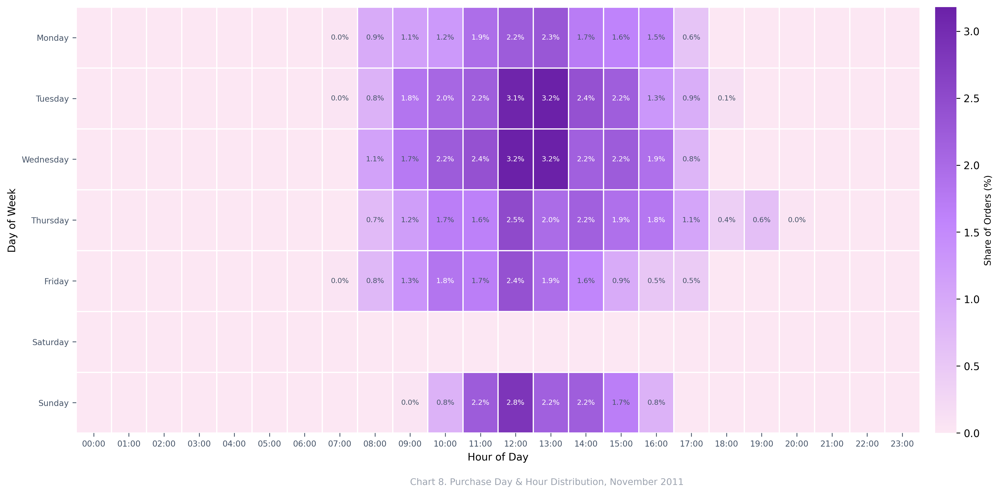

# Customer Growth and Retention Analysis

<div align="center">
  
</div>

**Author:** Dinh Thi Thanh Hang

<details open>
<summary><strong>1. Project Overview</strong></summary>

This project analyzes customer purchasing behavior, revenue performance, and churn risk using 500,000+ transaction records from a UK-based online retailer.

The analysis combines PySpark-based data processing, customer segmentation, behavioral analysis, and machine learning to identify growth opportunities and support data-driven customer retention strategies.

</details>

<details>
<summary><strong>2. Business Objectives</strong></summary>

- Evaluate revenue growth and purchasing performance.
- Identify high-value customer segments and their purchasing patterns.
- Understand customer retention and churn behavior.
- Identify behavioral signals associated with customer disengagement.
- Develop a churn prediction model to prioritize at-risk customers.
- Translate analytical findings into actionable growth and retention strategies.

</details>

<details>
<summary><strong>3. Dataset Overview</strong></summary>

The dataset contains transactional records from a UK-based online retailer between December 2010 and December 2011.

| Metric | Description |
|---|---|
| Transaction Records | 500,000+ |
| Observation Period | Dec 2010 – Dec 2011 |
| Business Context | Online Retail |
| Geographic Coverage | Primarily United Kingdom |
| Identified Customers | 4,334 |

**Key Fields**

| Field | Description |
|---|---|
| `InvoiceNo` | Transaction identifier |
| `StockCode` | Product identifier |
| `Description` | Product description |
| `Quantity` | Number of units purchased |
| `InvoiceDate` | Transaction timestamp |
| `UnitPrice` | Product unit price |
| `CustomerID` | Customer identifier |
| `Country` | Customer location |

</details>

<details>
<summary><strong>4. Key Business Metrics & Definitions</strong></summary>

| Metric | Definition |
|---|---|
| Revenue | `Quantity × UnitPrice` for valid purchase transactions |
| Total Orders | Number of distinct successful purchase invoices |
| Active Customers | Identified customers with successful purchases during the period |
| Average Order Value (AOV) | Total Revenue / Total Orders |
| Purchase Frequency | Number of successful purchase invoices per customer |
| Recency | Days since the customer's most recent successful purchase |
| Monetary Value | Total historical purchase value per customer |
| Cancellation Rate | Cancelled invoices relative to total purchase and cancellation activity |
| Churn | Customer inactivity and purchasing frequency-based behavioral proxy |

**Operational Churn Definition**

```text
Churn = 1 if Recency > 108 days AND Frequency <= 4
Churn = 0 otherwise
```

The dataset does not contain an explicit churn label. This rule-based definition is an operational proxy rather than directly observed customer attrition.

</details>

<details>
<summary><strong>5. Analytical Approach</strong></summary>

The analysis follows a growth-oriented framework, combining business performance diagnosis, the 3Ps analytical dimensions, and customer lifecycle analysis to identify opportunities for sustainable revenue growth.

### **5.1 Growth Diagnosis**

- Analyze revenue, customer, and order trends over time.
- Decompose revenue growth into customer base, purchase frequency, and average order value (AOV).
- Identify key growth drivers, performance changes, and seasonal patterns.

### **5.2 3Ps Analysis**

**Product**

- Analyze revenue and sales contribution by product, category, and subcategory.
- Identify top-performing products and customer product preferences.
- Examine product affinity and cross-selling opportunities.

**Place**

- Analyze revenue, order, and customer distribution across geographic markets.
- Compare purchasing patterns and customer value across locations.
- Identify high-potential markets and geographic growth opportunities.

**People**

- Segment customers based on purchasing behavior and monetary value.
- Identify high-value, low-engagement, and at-risk customer segments.
- Compare purchasing patterns and product preferences across customer groups.

### **5.3 Customer Lifecycle Analysis**

**Acquire**

- Analyze new customer trends and first-purchase behavior.
- Identify customer acquisition patterns across products and locations.
- Examine early repeat-purchase signals.

**Engage & Develop**

- Analyze repeat-purchase behavior, purchase frequency, and spending patterns.
- Identify opportunities to increase customer value through basket expansion and cross-selling.
- Examine differences in purchasing behavior across customer segments.

**Retain**

- Analyze cohort retention, customer inactivity, and churn patterns.
- Identify behavioral signals associated with customer disengagement.
- Evaluate customer segments with elevated churn risk.

### **5.4 Churn Prediction**

- Construct customer-level RFM and cancellation-related features.
- Define churn using a behavioral rule based on recency and frequency.
- Benchmark Logistic Regression, Random Forest, and LightGBM.
- Apply Out-of-Time validation to evaluate performance on unseen periods.
- Use SHAP to interpret important churn predictors.

</details>

<details open>
<summary><strong>6. Key Findings & Business Recommendations</strong></summary>

### 6.1 Revenue Growth & Performance Drivers

# 📈 Revenue Growth & Performance Drivers

> **Executive Summary:** Revenue demonstrated a two-phase trajectory throughout 2011: a stable baseline across H1 followed by a massive late-year inflection. Top-line expansion was overwhelmingly driven by **Customer Base Acquisition** and **late-year purchase frequency**, successfully offsetting compressed basket sizes during holiday promotions.

---

### **1. Top-Line Trajectory: Mid-Year Plateau to Q4 Inflexion**

* **Record Revenue Peak:** Monthly revenue climbed from **$562.7K (Jan)** to break the million-dollar barrier in October ($1.002M) before peaking at **$1.137M in November (+13.4% MoM)**.
* **Q4 Growth Acceleration:** After range-bound performance between Feb–Aug ($442K–$659K), sales surged starting September ($938.8K), driven by seasonal holiday demand.


---

### **2. Revenue Driver Decomposition: What Powered the Surge?**

$$\text{Revenue} = \text{Active Customers} \times \text{Order Frequency} \times \text{Average Order Value (AOV)}$$

#### **Primary Driver: Customer Acquisition Expansion (+125% YTD)**
* The customer base served as the core growth engine, expanding consistently from **739 active accounts in January to 1,660 in November (+124.6%)**.
* Massive customer influx began in September (+34.9% MoM jump to 1,259 accounts), sustaining momentum through October (1,361) and November (1,660).


#### **Secondary Driver: Late-Year Order Velocity & Purchase Frequency**
* Purchase frequency reached an annual high of **1.59 orders/customer in November (+13.8% MoM)**.
* Total order volume surged to **2,642 orders in November (+38.8% MoM)**, driving transaction velocity to record levels.

#### **Commercial Trade-off: Volume Elasticity vs. Basket Size (AOV)**
* Despite record top-line revenue in November, **AOV contracted sharply to $430.18 (-18.3% MoM)**.
* *Business Insight:* High-velocity seasonal discounting (e.g., Black Friday) compressed individual basket sizes, but explosive order volume and repeat purchases easily outweighed the discount impact, maximizing total revenue.


---

### 6. Customer Behavior: How to attract, engage and retain our customers? Any opportunities to increase monetary value from existing customer bases?

A deeper drill-down into customer cohorts reveals a critical strategic pivot: **top-line growth was sustained by Customer Retention, not new acquisitions.**

* **The Flipped Ratio:** While January was driven primarily by first-time buyers (**56% New vs. 44% Returning**), the balance rapidly shifted. From May onward, returning customers consistently made up **70%–80%+** of monthly active buyers.
* **November Re-engagement Wave:** At the record revenue peak in November, **81% of active buyers were Returning Customers** (only 19% new). The year-end surge was therefore an engine of **lifecycle reactivation** rather than high-cost new customer acquisition.


---

### **4. Purchasing Behavior: Strong B2B / Working-Hours Footprint**

Analysis of purchase distribution across days and hours highlights distinctive behavioral patterns resembling **B2B buyers, wholesalers, or office-hour shoppers**:

* **Strict Working-Hour Concentration:** Transaction activity is heavily clustered between **10:00 and 15:00 (Monday–Friday)**, with daily peaks consistently occurring around **12:00–13:00 (3.0%–3.3% share per hour slot)**.
* **Zero Saturday Activity & Late-Night Thursday:**
  * Orders on **Saturdays are completely non-existent (0.0%)**, and Sundays only capture minimal daytime activity (10:00–16:00).
  * **Thursday** is the sole day featuring extended evening purchasing (persisting until 19:00–20:00).
* **November Mid-Week Stocking (Peak Season):** In November, purchase volume concentrated even more intensely on **Tuesday & Wednesday mid-day (12:00–13:00 capturing ~3.2% of all monthly orders)**, pointing to deliberate mid-week inventory replenishment ahead of weekend retail demand.





---

---

### **5. Cohort Retention Analysis: The Leaky Bucket vs. The Sleeping Giants**

Analyzing monthly customer cohorts (*Chart 9*) resolves the apparent paradox between low monthly cohort retention and the 81% returning customer share:

* **The Month-1 Drop-off (The Leaky Bucket):** All 2011 cohorts experience an immediate, steep churn after acquisition—**only 15%–24% of new customers place a second order in Month 1**.
* **Stable Baseline Retention (Month 2+):** For customers surviving past Month 2, retention stabilizes remarkably well into a predictable baseline of **20%–27%**, indicating high stickiness among core converted buyers.
* **The Holiday Reactivation Wave (The Sleeping Giants):** Rather than churning permanently, dormant customers re-activate en masse during the year-end season:
  * Cohort `2010-12` spiked back to an extraordinary **50% retention in Month 11** (November).
  * Cohorts `2011-01` and `2011-06` rebounded to **37% and 33% retention**, respectively.
* **The Cumulative Pool Reality:** Because 11 historical cohorts re-engaged simultaneously in November, their aggregated volume formed **81% of active buyers**, dwarfing that single month's acquisition intake.


---

### **💡 Strategic Recommendations: Retain vs. Acquire**

> **Strategic Priority:** Shift resource allocation to **70% Retention & Lifecycle Marketing / 30% Targeted Acquisition**. Pouring budget into top-of-funnel acquisition while losing 80% of buyers within 30 days is commercially inefficient.

1. **Plug the "Month-1 Drop-off" (0–30 Days Post-Purchase):**
   * Implement automated post-purchase CRM triggers at **Day 14 and Day 25** offering a time-sensitive incentive for the **second order**. Securing order #2 is the single biggest predictor of long-term LTV.
2. **Systematize Reactivation Ahead of Q4:**
   * Do not wait for dormant accounts to passively return in November. Launch pre-season restocking outreach in **August–September** tailored to dormant accounts built up across H1.
3. **VIP Loyalty & Tiered Volume Pricing for Core Accounts:**
   * Protect high-retention cohorts (e.g., `2010-12` maintaining ~35%–50% retention) with dedicated B2B account management, volume discounts, and early-access wholesale promotions.

### ---

### **6. Product Portfolio & ABC Classification: Hero SKUs Anchor Revenue**

An ABC analysis of product performance (*Chart 10*) highlights the revenue structure across the product catalog and identifies key operational dependencies:

* **Top-Heavy Revenue Drivers (The "Hero" Products):**
  * Revenue among top performers drops precipitously: **SKU `23843` ($168K+)** and **SKU `22423` ($142K+)** substantially outpace the catalog, generating over **$310K combined**.
  * Beyond the top 3 SKUs, revenue stabilizes rapidly into a steady baseline, with items ranked 7th to 20th generating between $35K and $55K each.
* **Extensive Long-Tail Catalog:**
  * The cumulative revenue curve (pink line) shows that the **Top 20 SKUs account for only ~14% of total cumulative revenue**, far below the traditional 80% Pareto threshold (dotted line).
  * *Business Insight:* The business runs on a massive long-tail catalog. However, the top Class-A items serve as **Anchor Products** that wholesale and repeat buyers consistently return to replenish during peak periods.


---

### **Recommendations**

1. **Zero-Tolerance Stock-Outs on Top 5 SKUs:**
   * Because top items (`23843`, `22423`, `85123A`) generate outsized revenue, stock-outs during Q4 peak weeks represent severe top-line vulnerability. Implement **automated safety-stock buffers** and advance procurement contracts by late Q3.
2. **Leverage Anchor SKUs for Cross-selling**
   * Bundle high-velocity Class-A products with slower-moving Class-B/C accessories to stimulate basket depth and counteract the AOV compression observed during year-end promotions.

---
---

### **7. Customer Segmentation & Behavior: RFM Dynamics**

> **Executive Summary:** Top-line revenue exhibits extreme concentration risk: **Champions generate 64.7% (£5.66M) of total revenue**. Segment differences stem from **order cadence and basket depth, not product preference**—mature and lapsing segments purchase the exact same hero products.

---

#### **Key Takeaways & Cross-Chart Insights**

1. **Extreme Revenue Concentration (The "Whale" Dependency):**
   * **Champions account for £5.66M (64.7%)**, outpacing the second segment (*Loyal*, 10.5%) by 6x.
   * *Strategic Risk:* A 10% churn in Champions (~£566K) wipes out more revenue than the entire *Hibernating* base (£495K).
   * *The £1.48M Win-back Opportunity:* Lapsing pools (*At Risk* £828K + *Hibernating* £495K + *Need Attention* £155K) represent **17.0% of total revenue**.


2. **Intensity vs. Taste (Identical Catalogs, Divergent Velocities):**
   * Top products (*Heart T-Light Holder, Regency Cakestand, Party Bunting*) rank top-5 across *Champions, Loyal, At Risk,* and *Hibernating*.
   * Lapsed customers do not suffer from product mismatch; they simply stop reordering. Champions buy their core items **~3x per customer** (vs. 1.0–2.0x for other cohorts) and order with larger basket depth (e.g., Cakestand at £112/invoice for Champions vs. £33–£60 elsewhere).
   * *Wholesale Signal:* *At Risk* purchases Heart Holders at **25.2 units/invoice** (vs. Champions' 21.7), signaling inactive high-volume trade buyers.

3. **Uniform Mid-Week/Mid-Day B2B Rhythm:**
   * **No segment-level timing divergence:** All mature cohorts peak mid-day (**12:00–13:00 at 16%–18%**) and concentrate orders mid-week (**Tuesday–Thursday, peaking Thursday at 21%–24%**).
   * *Data Caveat:* The Tuesday spike (32%) and 14:00 peak for *New Customers* is a low-sample window artifact (n < 8 invoices/SKU)—not an intrinsic consumer habit.

| Purchase Day Distribution | Hourly Purchase Distribution |
| :---: | :---: |
|  |  |

---

#### **Segment Strategic Action Matrix**

| Segment | Revenue (% Share) | Core Behavior & Hero Products | Action Plan & Timing |
| :--- | :---: | :--- | :--- |
| **Champions** | **£5.66M** (64.7%) | Reorder ~3x; High basket (£112/inv on Cakestand). *Heart Holder, Cakestand, Jumbo Bag.* | **Protect (High):** Assign dedicated VIP account managers, volume tiers, and automated alerts on recency drift. |
| **At Risk** | **£828K** (9.5%) | High units/invoice (25.2 units on Heart Holder). B2B wholesale profile. | **Reactivate (High):** Automated volume-pricing win-back nudges for their previously purchased hero items. |
| **Loyal** | **£914K** (10.5%) | Steady reorders (~2x); flatter weekday profile across Tue–Thu. | **Upsell (High):** Automated replenishment cycles and multi-pack bundles to push cadence toward Champions. |
| **Hibernating / Need Attention** | **£650K** (7.5%) | Single-purchase behavior (~1.0x); sharp Thursday peak (~24%). | **Automate (Med):** Low-cost automated email reactivation featuring top proven catalog items; cap ad spend. |
| **Potential Loyalists / New** | **£498K** (5.7%) | Low frequency (~1.0–1.2x); low-ticket items (Playing Cards, Bags). | **Nurture (Med):** Day-14/Day-25 onboarding journey with second-order incentives on core hero lines. |

---

#### **Actionable Recommendations**
* **Standardize Operational Scheduling:** Consolidate marketing campaigns into a unified **Tuesday–Thursday morning window (09:30–11:00)** to intercept the universal 12:00–13:00 purchasing surge. Segment-specific scheduling adds complexity without data support.
* **Prioritize Cadence Over Discovery:** Win-back strategies should leverage proven anchor products (*Heart Holder, Cakestand*) via volume discounts and replenishment reminders, rather than pushing new catalog exploration.

### 6.5 Churn Prediction Performance

- LightGBM achieved an ROC-AUC of **0.77** using Out-of-Time validation.
- The model achieved **1.35× Lift@20%**.
- SHAP analysis highlighted cancellations, product diversity, and customer tenure among the important churn-related features.

*Business Implications:*
- Use model scores to prioritize retention outreach.
- Investigate cancellation behavior and declining product engagement.
- Combine predictive scores with customer value when allocating retention resources.

</details>

<details>
<summary><strong>7. Proposed Retention Strategy Framework</strong></summary>

| Customer Segment | Observed Behavior | Proposed Strategy |
|---|---|---|
| New Customers | Disengagement after 1–2 purchases | Onboarding and second-purchase incentives |
| Early At-Risk Customers | No repeat purchase within 30 days | Timely reminders and personalized recommendations |
| Single-Product Customers | Limited product engagement | Cross-selling and complementary product offers |
| High-Value Customers | High historical monetary contribution | Personalized offers and loyalty initiatives |
| High Churn-Risk Customers | Elevated model-predicted churn risk | Prioritized retention outreach |

The proposed framework is intended to guide future retention experiments. Its actual business impact would need to be measured through controlled campaign evaluation.

</details>

<details>
<summary><strong>8. Limitations & Further Analysis</strong></summary>

**Limitations**

- The dataset covers approximately one year, limiting the ability to assess long-term customer lifetime behavior.
- Churn is defined using a behavioral proxy rather than an explicitly observed customer attrition label.
- Customer-level analysis excludes transactions without a `CustomerID`.
- Predictive performance reflects the operational churn definition and does not necessarily represent confirmed customer attrition.
- Historical transaction data does not capture the impact of actual retention interventions.

**Further Analysis**

- Validate the churn definition using longer observation periods.
- Evaluate retention strategies through controlled experiments.
- Develop customer lifetime value (CLV) estimates.
- Monitor model performance and churn patterns over time.
- Assess the incremental revenue and retention impact of targeted interventions.

</details>

<details>
<summary><strong>9. Tools & Technologies</strong></summary>

**Data Processing**


**Data Analysis**


**Data Visualization**


**Machine Learning**


**Development Environment**


</details>
