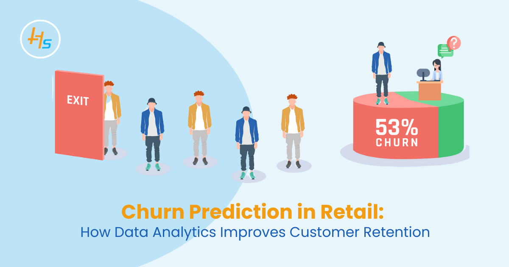
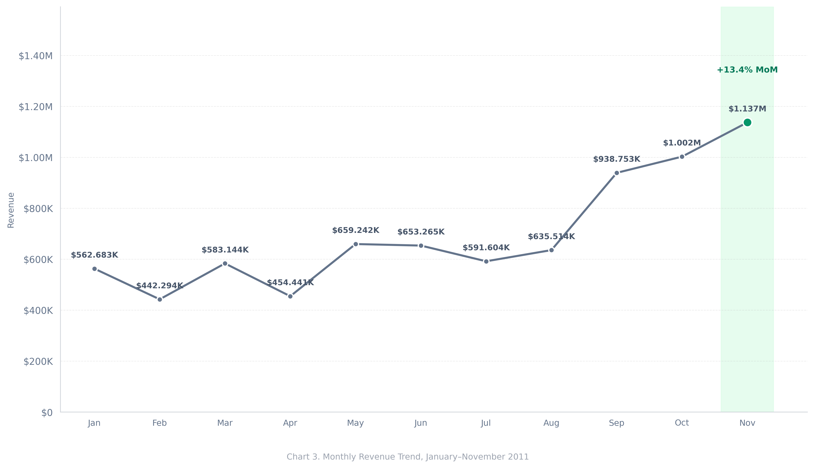
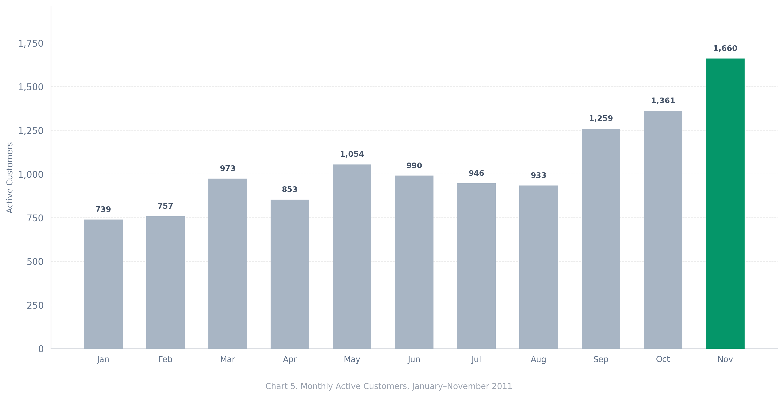
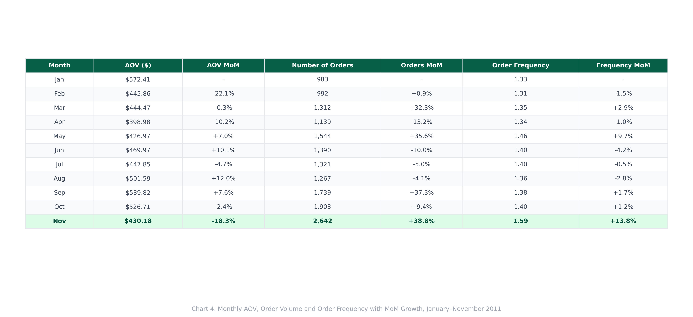
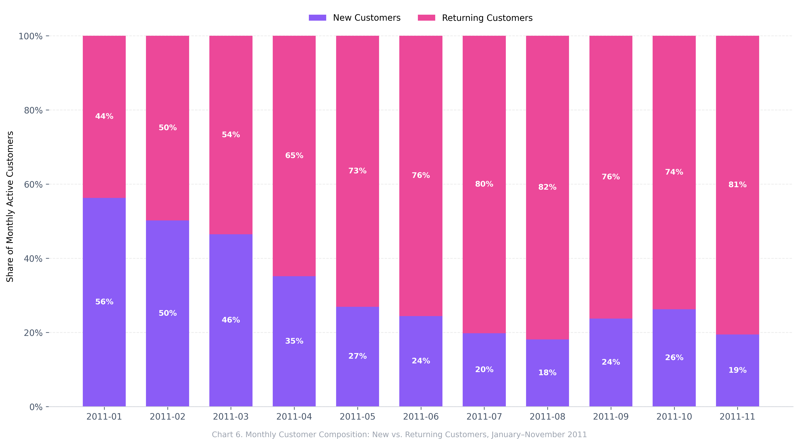
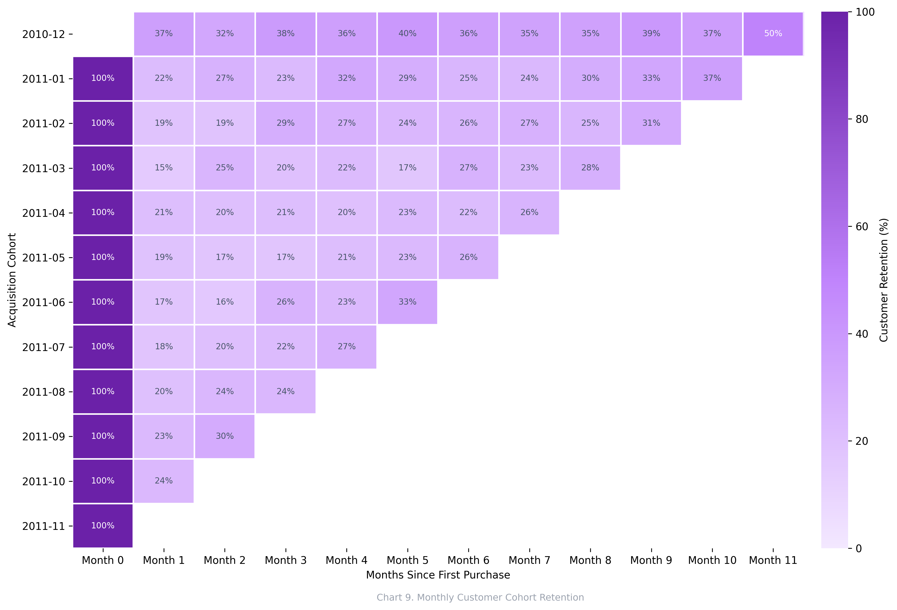
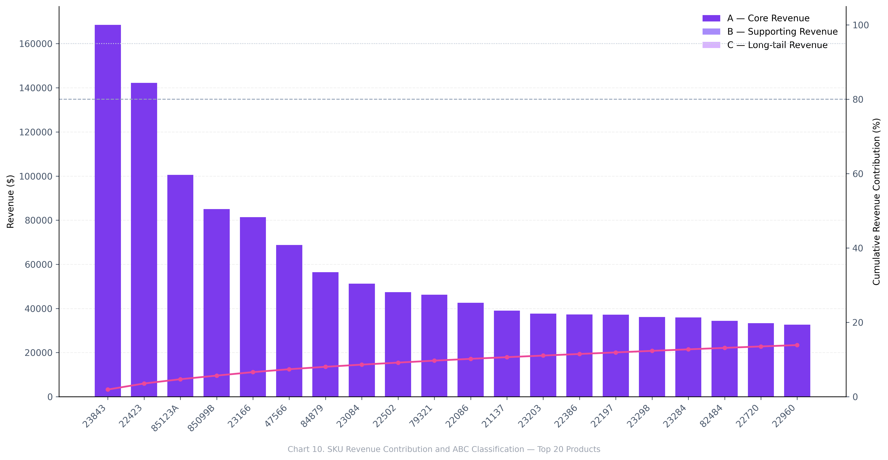
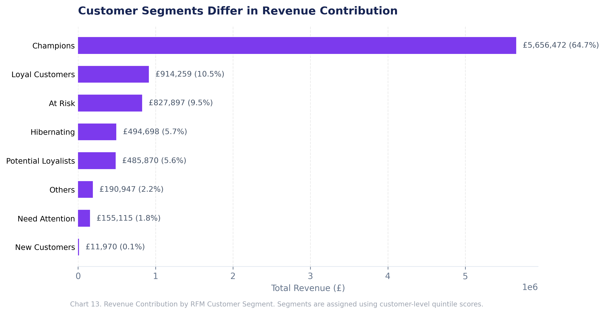
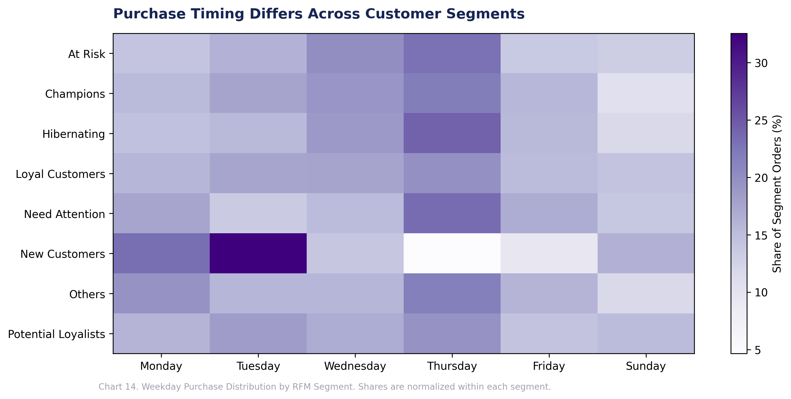
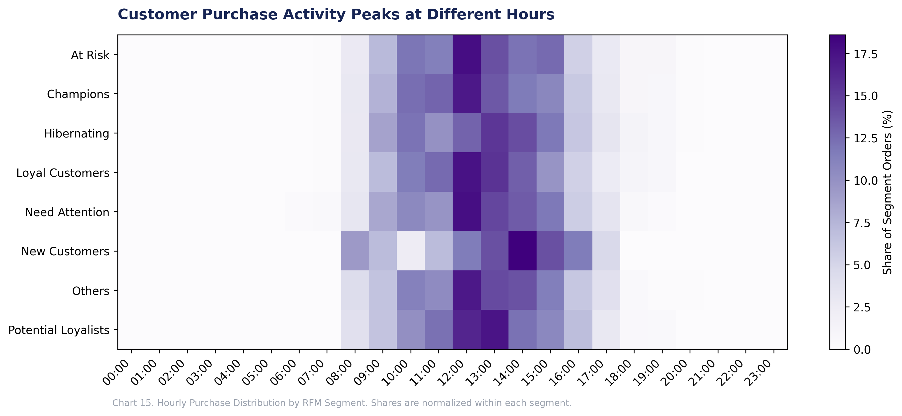

# Customer Growth and Retention Analysis

<div align="center">
  
</div>

**Author:** Dinh Thi Thanh Hang

<details open>
<summary><strong>1. Project Overview</strong></summary>

This project analyzes customer purchasing behavior, revenue performance, customer segmentation, and churn risk using 500,000+ transaction records from a UK-based online retailer.

The analysis combines PySpark-based data processing, exploratory data analysis (EDA), RFM segmentation, cohort analysis, and machine learning to uncover revenue growth drivers, identify valuable customer segments, and develop data-driven retention strategies.

**Key Analytical Areas**
- Revenue growth and performance driver decomposition.
- Customer acquisition, retention, and purchasing behavior.
- Cohort retention and customer lifecycle analysis.
- RFM-based customer segmentation.
- Product portfolio and geographic revenue analysis.
- Churn prediction using LightGBM and SHAP.

</details>

<details>
<summary><strong>2. Business Objectives</strong></summary>

- Evaluate revenue growth and purchasing performance.
- Identify high-value customer segments and their purchasing patterns.
- Understand customer retention and churn behavior.
- Identify behavioral signals associated with customer disengagement.
- Develop a churn prediction model to prioritize at-risk customers.
- Translate analytical findings into actionable growth and retention strategies.

</details>

<details>
<summary><strong>3. Dataset Overview</strong></summary>

The dataset contains transactional records from a UK-based online retailer between December 2010 and December 2011.

| Metric | Description |
|---|---|
| Transaction Records | 500,000+ |
| Observation Period | Dec 2010 – Dec 2011 |
| Business Context | Online Retail |
| Geographic Coverage | Primarily United Kingdom |
| Identified Customers | 4,334 |

**Key Fields**

| Field | Description |
|---|---|
| `InvoiceNo` | Transaction identifier |
| `StockCode` | Product identifier |
| `Description` | Product description |
| `Quantity` | Number of units purchased |
| `InvoiceDate` | Transaction timestamp |
| `UnitPrice` | Product unit price |
| `CustomerID` | Customer identifier |
| `Country` | Customer location |

</details>

<details>
<summary><strong>4. Key Business Metrics & Definitions</strong></summary>

| Metric | Definition |
|---|---|
| Revenue | `Quantity × UnitPrice` for valid purchase transactions |
| Total Orders | Number of distinct successful purchase invoices |
| Active Customers | Identified customers with successful purchases during the period |
| Average Order Value (AOV) | Total Revenue / Total Orders |
| Purchase Frequency | Number of successful purchase invoices per customer |
| Recency | Days since the customer's most recent successful purchase |
| Monetary Value | Total historical purchase value per customer |
| Cancellation Rate | Cancelled invoices relative to total purchase and cancellation activity |
| Churn | Customer inactivity and purchasing frequency-based behavioral proxy |

**Operational Churn Definition**

```text
Churn = 1 if Recency > 108 days AND Frequency <= 4
Churn = 0 otherwise
```

The dataset does not contain an explicit churn label. This rule-based definition is an operational proxy rather than directly observed customer attrition.

</details>

---

# 5. Key Business Insights

<details open>
<summary><strong>5.1. Revenue Growth & Performance Drivers</strong></summary>

### Executive Summary

Revenue demonstrated a two-phase trajectory throughout 2011: a relatively stable baseline across the first half, followed by a substantial late-year acceleration.

Revenue expansion was primarily supported by a growing active customer base and increased purchase frequency, offsetting the decline in average order value during the peak season.

**1. Top-Line Trajectory: Mid-Year Plateau to Q4 Acceleration**

- **Record Revenue Peak:** Monthly revenue increased from approximately £562.7K in January to £1.002M in October, before peaking at £1.137M in November (+13.4% MoM).
- **Q4 Growth Acceleration:** Following relatively stable monthly performance between February and August (£442K–£659K), revenue accelerated significantly from September (£938.8K).



**2. Revenue Driver Decomposition: What Powered the Surge?**

Revenue can be decomposed into three fundamental drivers:

\[
Revenue = Active\ Customers \times Order\ Frequency \times AOV
\]

**Primary Driver: Active Customer Growth (+125% YTD)**

The active customer base expanded from 739 customers in January to 1,660 in November (+124.6%).

- Customer growth accelerated in September, with a 34.9% MoM increase to 1,259 customers.
- The upward trend continued through October (1,361) and November (1,660).



**Secondary Driver: Increased Purchase Frequency**

- Purchase frequency reached an annual high of 1.59 orders/customer in November (+13.8% MoM).
- Total order volume surged to 2,642 orders (+38.8% MoM), driving transaction velocity to record levels.

**Commercial Trade-off: Volume Growth vs. Basket Size**

Despite reaching record revenue in November, AOV contracted to £430.18 (-18.3% MoM).

**Business Insight:** The simultaneous increase in order volume and decline in AOV suggests a volume-driven growth pattern. Seasonal promotions and increased purchasing activity may have encouraged more frequent transactions while compressing individual basket values.



</details>

<details>
<summary><strong>5.2. Customer Acquisition vs. Retention</strong></summary>

### Executive Summary

The late-year revenue surge was sustained primarily by returning customers rather than new customer acquisition.

**The Shift from Acquisition to Retention**

- In January, first-time buyers accounted for 56% of active customers, compared with 44% returning customers.
- From May onward, returning customers consistently represented approximately 70%–80%+ of monthly active buyers.
- In November, returning customers accounted for 81% of active buyers, while new customers represented only 19%.

**Business Insight:** The year-end growth was largely driven by the re-engagement of existing customers and accumulated customer relationships, rather than new customer acquisition alone.

This highlights the importance of lifecycle marketing and customer retention in sustaining revenue growth.



</details>

<details>
<summary><strong>5.3. Purchasing Behavior: B2B / Working-Hours Footprint</strong></summary>

Analysis of purchasing activity across weekdays and hours reveals distinctive behavioral patterns resembling B2B buyers, wholesalers, or office-hour shoppers.

**Working-Hour Concentration**

- Transaction activity is heavily concentrated between 10:00 and 15:00, particularly from Monday to Friday.
- Daily purchasing peaks consistently occur around 12:00–13:00, accounting for approximately 3.0%–3.3% of hourly transaction activity.

**Distinctive Weekly Patterns**

- Saturday transactions are completely absent in the observed dataset.
- Sunday activity is limited primarily to daytime hours (10:00–16:00).
- Thursday is the only weekday with extended evening purchasing activity, continuing until approximately 19:00–20:00.

**November Mid-Week Purchasing**

During November, purchasing activity became even more concentrated around Tuesday and Wednesday midday, with 12:00–13:00 accounting for approximately 3.2% of monthly orders.

**Business Insight:** The consistent weekday and midday purchasing patterns suggest a substantial business-oriented customer base. This may indicate wholesale purchasing and inventory replenishment behavior rather than purely individual consumer shopping.


</details>

<details>
<summary><strong>5.4. Cohort Retention Analysis: The Leaky Bucket vs. Sleeping Giants</strong></summary>

### Executive Summary

Cohort analysis reveals an important distinction between monthly customer retention and the cumulative returning customer base.

Although individual acquisition cohorts experience substantial early drop-off, customers from older cohorts can return after extended periods of inactivity.

**1. The Month-1 Drop-off**

All observed 2011 acquisition cohorts experience a significant decline in the first month after acquisition.

- Only 15%–24% of newly acquired customers place a second order in Month 1.
- This indicates a substantial opportunity to improve early customer engagement and encourage repeat purchases.

**2. Stable Baseline Retention**

For customers who remain engaged beyond the initial period, retention stabilizes at approximately 20%–27% across subsequent cohort months.

This suggests that customers who successfully transition into repeat purchasing behavior may develop relatively consistent purchasing patterns.

**3. The Holiday Reactivation Wave**

Dormant customers from earlier cohorts re-engaged during the year-end season:

- December 2010 cohort reached approximately 50% retention in Month 11.
- January 2011 cohort rebounded to 37%.
- June 2011 cohort rebounded to 33%.

**4. The Cumulative Customer Base Effect**

The 81% returning customer share observed in November is not inconsistent with low monthly cohort retention.

Returning customers include buyers acquired across multiple historical cohorts. Their simultaneous reactivation creates a substantial pool of returning demand, even when individual cohorts have relatively low month-to-month retention.

**Business Insight:** Customer inactivity should not automatically be interpreted as permanent churn. Historical purchasing behavior suggests that some dormant customers retain the potential to reactivate, particularly during seasonal demand periods.



### Strategic Recommendations: Retain vs. Acquire

**Priority 1: Address the Month-1 Drop-off**

Implement automated post-purchase CRM triggers:

- Day 14: Personalized product recommendations based on the first purchase.
- Day 25: Time-sensitive incentives to encourage a second purchase.

The objective is to convert first-time buyers into repeat customers before engagement declines.

**Priority 2: Systematize Seasonal Reactivation**

Launch pre-season reactivation campaigns in August–September rather than waiting for dormant customers to return organically in November.

Prioritize customers with historical purchasing activity during previous peak seasons.

**Priority 3: Protect High-Value Customers**

Introduce loyalty initiatives for established repeat buyers:

- Dedicated account management for high-value wholesale customers.
- Tiered volume discounts.
- Early access to seasonal and wholesale promotions.
- Automated alerts when purchasing recency begins to deteriorate.

</details>

<details>
<summary><strong>5.5. Product Portfolio Analysis & ABC Classification</strong></summary>

### Executive Summary

ABC analysis highlights a highly diversified product catalog with a relatively small number of high-performing SKUs generating substantial individual revenue contributions.

**1. Top-Performing Products**

Revenue among leading products drops sharply:

- SKU 23843 generates more than £168K.
- SKU 22423 generates more than £142K.
- Together, these two products contribute over £310K in revenue.

Beyond the top three SKUs, revenue stabilizes relatively quickly, with products ranked 7th–20th generating approximately £35K–£55K each.

**2. Extensive Long-Tail Catalog**

The cumulative revenue curve indicates that the Top 20 SKUs account for approximately 14% of total revenue, substantially below the traditional 80% Pareto threshold.

**Business Insight:** Revenue is distributed across a broad product catalog rather than being concentrated exclusively in a small number of SKUs.

However, leading Class-A products remain important anchor products that wholesale and repeat customers consistently purchase, particularly during peak periods.



### Supply Chain & Merchandising Recommendations

**Protect High-Performing SKUs**

- Prioritize inventory availability for the Top 5 revenue-generating products.
- Establish automated safety-stock thresholds.
- Plan procurement ahead of Q4 seasonal demand.

**Leverage Anchor Products for Cross-Selling**

Bundle high-performing Class-A products with complementary Class-B/C items to:

- Increase basket depth.
- Encourage broader product discovery.
- Counteract AOV compression during promotional periods.

</details>

<details>
<summary><strong>5.6. RFM Customer Segmentation & Behavior</strong></summary>

### Executive Summary

RFM segmentation reveals substantial revenue concentration among high-value customers, alongside meaningful reactivation opportunities within at-risk and dormant segments.

Champions contribute 64.7% of total revenue, highlighting the importance of protecting established customer relationships.

**1. Revenue Concentration: The Champion Dependency**

- Champions generate £5.66M, representing 64.7% of total revenue.
- The Loyal segment contributes £914K (10.5%).
- At Risk customers contribute £828K (9.5%).
- Hibernating and Need Attention customers collectively contribute approximately £650K (7.5%).

**Strategic Risk:** A hypothetical 10% revenue loss among Champions would put approximately £566K at risk, exceeding the entire Hibernating segment's historical revenue contribution (£495K).

**2. The £1.48M Win-Back Opportunity**

Customers in declining-engagement segments represent a meaningful reactivation opportunity:

| Segment | Historical Revenue |
|---|---:|
| At Risk | £828K |
| Hibernating | £495K |
| Need Attention | £155K |
| **Total** | **£1.48M** |



**3. Purchasing Intensity vs. Product Preference**

Top-performing products, including Heart T-Light Holder, Regency Cakestand, and Party Bunting, consistently rank among the leading products across Champions, Loyal, At Risk, and Hibernating segments.

This suggests that differences between customer segments are more closely associated with purchasing frequency and order value than fundamentally different product preferences.

Examples:

- Champions purchase core products approximately 3x per customer, compared with 1.0–2.0x among other segments.
- Regency Cakestand generates approximately £112/invoice among Champions, compared with £33–£60 across other cohorts.
- At Risk customers purchase Heart T-Light Holder at 25.2 units/invoice, compared with 21.7 among Champions.

**Wholesale Signal:** At Risk customers exhibit relatively high purchasing quantities, suggesting that some inactive customers may be valuable wholesale accounts rather than low-value individual shoppers.

**4. Consistent B2B Purchasing Patterns**

Mature customer segments demonstrate similar purchasing behavior:

- Purchasing activity peaks around 12:00–13:00, representing approximately 16%–18% of segment-level activity.
- Tuesday–Thursday account for the majority of weekday purchasing, with Thursday contributing approximately 21%–24%.

**Data Caveat:** The Tuesday spike (32%) and 14:00 peak among New Customers are based on a very small sample (fewer than 8 invoices/SKU) and should not be interpreted as representative behavioral patterns.

| Weekday Preferences | Hourly Purchase Distribution |
|---|---|
|  |  |

### Segment Strategic Action Matrix

| Customer Segment | Revenue | Core Behavior | Recommended Action |
|---|---:|---|---|
| Champions | £5.66M (64.7%) | High purchasing frequency and basket value | **Protect:** VIP account management, volume tiers, and recency monitoring |
| At Risk | £828K (9.5%) | High units/invoice; potential wholesale buyers | **Reactivate:** Personalized win-back offers and volume pricing |
| Loyal | £914K (10.5%) | Consistent repeat purchasing | **Upsell:** Replenishment reminders and multi-pack bundles |
| Hibernating / Need Attention | £650K (7.5%) | Low purchasing frequency and declining engagement | **Automate:** Low-cost email reactivation campaigns |
| Potential Loyalists / New | £498K (5.7%) | Low purchase frequency and relatively low-ticket products | **Nurture:** Day-14/Day-25 onboarding and second-order incentives |

### Geographic Footprint Across RFM Segments

Cross-analyzing geography against RFM tiers reveals that international revenue is disproportionately concentrated among high-value customers.

**1. Universal UK Customer Base**

The United Kingdom accounts for approximately 80%–92% of customer segment activity across RFM tiers.

However, international customers contribute disproportionately to revenue within higher-value segments.

**2. High-Value International Customers**

Nearly 20% of Champions revenue originates outside the UK.

Key international markets include:

| Country | Share of Champions Revenue |
|---|---:|
| Netherlands | 5.0% |
| EIRE / Ireland | 4.5% |
| Germany | 2.5% |
| Australia | 2.3% |

These markets demonstrate meaningful international wholesale purchasing activity.

**3. Emerging Acquisition Opportunity in Germany**

Germany represents 10.6% of revenue within the New Customers segment, suggesting emerging international acquisition potential that warrants further investigation.


### Actionable Recommendations

**Standardize Operational Scheduling**

Consolidate marketing campaigns into a unified Tuesday–Thursday morning window (09:30–11:00) to reach customers ahead of the observed midday purchasing peak.

**Prioritize Purchasing Cadence Over Product Discovery**

Use proven anchor products, such as Heart T-Light Holder and Regency Cakestand, in win-back campaigns.

Focus on replenishment reminders and volume-based offers rather than broad product discovery campaigns.

**Prioritize International Account Management**

International high-value customers require more than generic consumer marketing.

Consider dedicated B2B shipping rates, customized invoicing workflows, and localized account management for key overseas markets.

</details>

<details>
<summary><strong>5.7. Geographic Revenue Distribution & Market Expansion</strong></summary>

### Executive Summary

Geographic revenue demonstrates substantial dependence on the domestic UK market, with international sales primarily concentrated in Western Europe.

**1. Domestic Market Dominance**

The United Kingdom contributes approximately £7.24M, accounting for 82.9% of total revenue.

**2. International Revenue Concentration**

Non-UK revenue represents approximately 17.1% of total sales, with the largest international markets concentrated in Western Europe.

| Country | Revenue | Revenue Share |
|---|---:|---:|
| Netherlands | £284K | 3.2% |
| EIRE / Ireland | £257K | 2.9% |
| Germany | £205K | 2.4% |
| France | £184K | 2.1% |
| Australia | £138K | 1.6% |
| Japan | £37K | 0.4% |

**Business Insight:** More than 93% of revenue originates from the UK and neighboring Western European markets.

This geographic concentration suggests that logistics efficiency, fulfillment reliability, and cross-border shipping costs are important operational considerations.


### Strategic Implications

- Prioritize warehouse capacity and fulfillment SLAs for the UK market.
- Optimize shipping costs across major UK–EU trade corridors.
- Investigate opportunities to expand in established international markets such as the Netherlands, Ireland, and Germany.
- Evaluate the commercial potential of emerging markets using customer value and repeat purchasing behavior rather than revenue alone.

</details>

<details>
<summary><strong>5.8. Churn Prediction Performance</strong></summary>

### Model Performance

LightGBM achieved the following results using Out-of-Time (OOT) validation:

| Metric | Performance |
|---|---:|
| ROC-AUC | 0.77 |
| Lift@20% | 1.35x |

**Model Interpretation**

- ROC-AUC of 0.77 indicates useful discrimination between customers classified as churn-risk and non-churn-risk under the operational churn definition.
- Lift@20% of 1.35 indicates that the highest-risk 20% of customers contain approximately 1.35 times the churn concentration of the overall population.

**Key Churn-Related Features**

SHAP analysis identified several important behavioral signals:

- Cancellation-related behavior.
- Product diversity.
- Customer tenure.

### Business Implications

The model can support more targeted retention decisions by:

1. Prioritizing customers with elevated predicted churn risk.
2. Investigating cancellation behavior and declining product engagement.
3. Combining predicted churn probability with historical customer value.
4. Allocating retention resources toward customers with both high business value and elevated disengagement risk.

**Key Takeaway:** Predictive modeling provides an additional layer of prioritization on top of traditional RFM segmentation, helping identify customers who may require earlier retention intervention.

</details>

---

# 6. Proposed Retention Strategy Framework

The following framework translates the analytical findings into potential customer lifecycle interventions.

| Customer Segment | Observed Behavior | Proposed Strategy |
|---|---|---|
| New Customers | Disengagement after 1–2 purchases | Onboarding and second-purchase incentives |
| Early At-Risk Customers | No repeat purchase within 30 days | Timely reminders and personalized recommendations |
| Single-Product Customers | Limited product engagement | Cross-selling and complementary product offers |
| High-Value Customers | High historical monetary contribution | Personalized offers and loyalty initiatives |
| High Churn-Risk Customers | Elevated model-predicted churn risk | Prioritized retention outreach |

The proposed framework is intended to guide future retention experiments.

Its actual business impact would need to be measured through controlled campaign evaluation, with incremental revenue, repeat purchase rate, and customer retention as potential success metrics.

<details>
<summary><strong>7. Limitations & Further Analysis</strong></summary>

### Limitations

- **Limited Observation Period:** The dataset covers approximately one year, limiting the ability to assess long-term customer lifetime behavior.
- **Proxy-Based Churn Definition:** Churn is defined using a behavioral proxy rather than an explicitly observed customer attrition label.
- **Incomplete Customer Identification:** Customer-level analysis excludes transactions without a `CustomerID`.
- **Model Generalizability:** Predictive performance reflects the operational churn definition and does not necessarily represent confirmed customer attrition.
- **No Intervention Data:** Historical transaction records do not capture the actual impact of retention campaigns or other customer interventions.

### Further Analysis

- Validate the churn definition using longer observation periods.
- Evaluate retention strategies through controlled experiments.
- Develop customer lifetime value (CLV) estimates.
- Monitor model performance and changing churn patterns over time.
- Assess the incremental revenue and retention impact of targeted interventions.

</details>

<details>
<summary><strong>8. Tools & Technologies</strong></summary>

**Data Processing**


**Data Analysis**


**Data Visualization**


**Machine Learning**


**Development Environment**


</details>

<details>
<summary><strong>9. Project Conclusion</strong></summary>

This analysis highlights three major opportunities for improving customer growth and retention:

1. **Improve Early Customer Retention:** Address the substantial Month-1 drop-off through structured onboarding and second-purchase incentives.
2. **Protect High-Value Customer Relationships:** Prioritize Champions and high-value international accounts through personalized retention and replenishment strategies.
3. **Enable Proactive Retention:** Combine RFM segmentation with churn prediction to identify valuable customers at risk of disengagement.

By integrating transactional analysis, customer segmentation, and predictive modeling, the project demonstrates how historical purchasing data can support more informed commercial decisions and customer lifecycle management.

</details>
